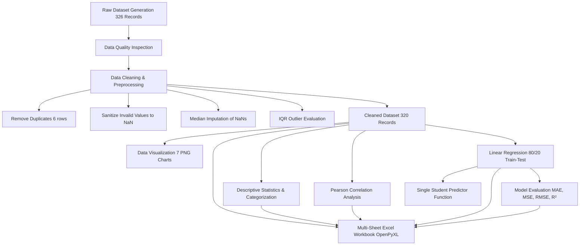

# Student Academic Performance Analysis Using Python and Excel
**A Mini-Project Report Submitted in Partial Fulfillment of Data Analytics and Visualization (DAV)**

---

## 1. Title Page

* **Project Title:** Student Academic Performance Analysis Using Python and Excel
* **Domain:** Data Analytics, Educational Data Mining, Statistical Modeling, and Machine Learning
* **Tools & Technologies:** Python 3.10+, Google Colab, Pandas, NumPy, Matplotlib, Seaborn, Scikit-learn, OpenPyXL, Microsoft Excel
* **Target Users:** Academic Advisors, University Faculty, Educational Administrators, and Students

---

## 2. Abstract

Predicting and understanding student academic outcomes is essential for timely pedagogical interventions and personalized student support. This project presents an end-to-end data analytics and statistical modeling pipeline designed to evaluate student performance using synthetic but statistically representative academic records ($N = 320$). The pipeline integrates automated data cleaning (handling duplicates, missing values via median imputation, and domain-bound validations), exploratory data analysis (EDA), descriptive statistics, Interquartile Range (IQR) outlier evaluation, Pearson correlation analysis, rich data visualizations, and an ordinary least squares (OLS) Linear Regression model implemented via Scikit-Learn.

The resulting predictive model achieves a coefficient of determination ($R^2$) of **0.8183** on an independent test dataset (80/20 train-test split), with a Root Mean Squared Error (RMSE) of **4.3154** and Mean Absolute Error (MAE) of **3.1291**. The strongest positive drivers of final examination success are identified as Assignment Scores ($r = 0.7607$) and Internal Assessment Marks ($r = 0.7441$). A companion multi-sheet formatted Microsoft Excel workbook (`Student_Academic_Performance_Analysis.xlsx`) is generated automatically using OpenPyXL, equipped with native formulas (`AVERAGE`, `COUNT`, `SUM`), cell formatting, and auto-filters to bridge Python data science workflows with accessible office spreadsheet tools.

---

## 3. Introduction

Higher education institutions generate vast quantities of academic telemetry, ranging from daily classroom attendance and assignment completion rates to continuous internal assessments. Without systematic data analytics workflows, identifying at-risk students prior to final examinations is difficult. This project leverages the combined power of **Python** (for scalable, reproducible computing, statistical estimation, and machine learning) and **Microsoft Excel** (for executive reporting, dynamic filtering, and spreadsheet accessibility) to deliver an academic analytics solution.

---

## 4. Problem Statement

Traditional academic performance evaluation is retrospective: interventions are frequently staged only after final examination grades are posted, when remediation options are limited. Furthermore, academic data collected across disparate departmental portals often suffers from data hygiene defects—such as missing records, duplicate submissions, and erroneous out-of-range marks. There is an institutional need for:
1. An automated data cleaning pipeline to sanitize student academic records.
2. Robust statistical quantification of study habits and continuous assessments.
3. A transparent machine learning model capable of estimating final examination marks early in the semester.

---

## 5. Aim and Objectives

### Aim
To analyze student academic performance using Python and Excel by implementing data cleaning, descriptive statistics, visual analytics, correlation analysis, and Linear Regression.

### Objectives
1. **Dataset Synthesis & Ingestion:** Construct a realistic synthetic academic dataset ($N \ge 300$) featuring deliberate anomalies (duplicates, null values, invalid scores) to demonstrate real-world data preprocessing.
2. **Data Cleaning & Quality Assurance:** Detect and resolve missing values, duplicate entries, and out-of-bounds domain errors; evaluate outliers via IQR.
3. **Statistical & Categorical Analysis:** Compute central tendency and dispersion metrics; categorize students into performance bands (*Excellent*, *Good*, *Average*, *Needs Improvement*).
4. **Correlation Analysis:** Quantify linear associations between academic predictors and final marks using Pearson correlation coefficients.
5. **Data Visualization:** Generate seven publication-quality charts illustrating distributions, relationships, category breakdowns, and residual behavior.
6. **Machine Learning Modeling:** Train and validate a multiple Linear Regression model to predict final marks and explain feature contributions.
7. **Excel Integration:** Export cleaned data, statistical summaries, correlation tables, evaluation metrics, and predictions to a styled, formula-equipped Excel workbook.

---

## 6. Scope of the Project

* **Analytical Scope:** Focuses on five primary predictors: Attendance Percentage, Daily Study Hours, Assignment Scores, Internal Assessment Marks, and Previous Semester Marks.
* **Target Audience:** College mentors, class coordinators, and academic deans seeking an early-warning diagnostic tool.
* **Deliverable Formats:** Interactive Google Colab Notebook, clean CSV files, PNG visualizations, Python ML model pickle, and a formatted multi-sheet Excel workbook.

---

## 7. Hardware and Software Requirements

### Hardware Requirements
* **Processor:** Intel Core i3 / AMD Ryzen 3 or higher (or cloud-allocated Google Colab CPU runtime).
* **RAM:** Minimum 4 GB (8 GB recommended; Colab provides ~12 GB RAM).
* **Storage:** 500 MB free disk space for datasets, plots, and workbook outputs.

### Software Requirements
* **Operating System:** Platform independent (Windows 10/11, macOS, Linux, or ChromeOS).
* **Environment:** Google Colab / Jupyter Notebook / VS Code.
* **Programming Language:** Python 3.9+
* **Libraries:**
  * `pandas`: DataFrame manipulation and tabular data management.
  * `numpy`: Vectorized numerical calculations.
  * `matplotlib` & `seaborn`: Data visualization and chart design.
  * `scikit-learn`: Data splitting, regression modeling, and performance metrics.
  * `openpyxl`: Excel workbook generation, styling, and formula injection.
  * `joblib`: Model serialization.
* **Office Software:** Microsoft Excel 2016+ or LibreOffice Calc.

---

## 8. Dataset Description

The project utilizes a synthetic dataset designed to mirror realistic university academic distributions:

| Attribute Name | Data Type | Permissible Range | Practical Description |
| :--- | :--- | :--- | :--- |
| **Student_ID** | String (Categorical) | `STU1001` - `STU1320` | Unique alphanumeric student identifier |
| **Gender** | String (Categorical) | `Male`, `Female` | Student demographic indicator |
| **Attendance_Percentage** | Float (Numerical) | `0.0%` - `100.0%` | Semester classroom attendance percentage |
| **Study_Hours** | Float (Numerical) | `0.0` - `16.0` hrs/day | Average self-study hours outside lectures |
| **Assignment_Score** | Float (Numerical) | `0.0` - `100.0` marks | Continuous assignment evaluations average |
| **Internal_Marks** | Float (Numerical) | `0.0` - `100.0` marks | Mid-term and practical internal assessments |
| **Previous_Semester_Marks** | Float (Numerical) | `0.0` - `100.0` marks | Historical cumulative GPA converted to % |
| **Final_Marks** | Float (Target Numerical) | `0.0` - `100.0` marks | Semester end final examination score |

To emulate real-world data collection issues, the raw dataset was populated with:
* 6 duplicate records.
* 11 random missing values (`NaN`) spread across columns.
* 4 invalid out-of-range values (e.g., Attendance = $145\%$, Study Hours = $-3.5$, Internal Marks = $-10$).

---

## 9. Methodology

---

## 10. Data Cleaning and Preprocessing

1. **Duplicate Detection & Removal:**
   $$\text{Duplicates Removed} = 6$$
   Exact identical rows are purged using Pandas `.drop_duplicates()`.
2. **Domain Range Validation:**
   Values failing logical domain constraints ($[0, 100]$ for percentages and marks, $[0, 16]$ for study hours) were detected and reset to `NaN` so that skewed or erroneous measurements do not corrupt downstream models.
3. **Missing Value Imputation:**
   Missing values were imputed using column-wise **Medians** rather than means:
   $$\text{Imputed Value} = \text{Median}(X_j)$$
   Median imputation was selected because medians are resilient against extreme values and preserve ordinal distribution shape.
4. **Outlier Evaluation via Interquartile Range (IQR):**
   $$IQR = Q_3 - Q_1$$
   $$\text{Lower Bound} = Q_1 - 1.5 \times IQR, \quad \text{Upper Bound} = Q_3 + 1.5 \times IQR$$
   *Outlier Retention Rationale:* In academic data, an exceptionally diligent student achieving 9.2 study hours or a student scoring high marks is not a measurement error, but a genuine high performer. Deleting genuine records introduces sample bias; therefore, verified valid scores are retained.

---

## 11. Statistical Analysis

### Descriptive Statistics Summary ($N = 320$ Cleaned Records)

| Variable | Mean | Median | Mode | Std Dev | Variance | Min | Max | Range | Q1 (25%) | Q3 (75%) |
| :--- | :---: | :---: | :---: | :---: | :---: | :---: | :---: | :---: | :---: | :---: |
| **Attendance_Percentage** | 75.75 | 75.80 | 100.00 | 11.57 | 133.86 | 40.00 | 100.00 | 60.00 | 67.57 | 83.50 |
| **Study_Hours** | 4.61 | 4.55 | 4.40 | 1.76 | 3.11 | 0.50 | 9.20 | 8.70 | 3.50 | 5.70 |
| **Assignment_Score** | 71.95 | 72.00 | 72.00 | 9.54 | 90.99 | 43.20 | 96.60 | 53.40 | 65.55 | 78.32 |
| **Internal_Marks** | 68.90 | 68.40 | 60.70 | 9.52 | 90.64 | 47.40 | 92.30 | 44.90 | 61.48 | 76.12 |
| **Previous_Semester_Marks** | 69.90 | 69.70 | 69.70 | 11.47 | 131.56 | 40.00 | 98.00 | 58.00 | 62.20 | 77.40 |
| **Final_Marks** | 69.59 | 69.65 | 59.20 | 9.82 | 96.46 | 44.70 | 100.00 | 55.30 | 63.18 | 76.32 |

### Performance Categorization Distribution

| Performance Category | Score Range | Student Count | Percentage (%) | Average Final Marks |
| :--- | :---: | :---: | :---: | :---: |
| **Excellent** | $85.00 - 100.00$ | 19 | 5.94% | 89.85 |
| **Good** | $70.00 - 84.99$ | 135 | 42.19% | 75.95 |
| **Average** | $50.00 - 69.99$ | 157 | 49.06% | 62.95 |
| **Needs Improvement** | $< 50.00$ | 9 | 2.81% | 47.21 |
| **Total** | -- | **320** | **100.00%** | **69.59** |

---

## 12. Correlation Analysis

The Pearson product-moment correlation coefficient measures linear dependency:
$$r = \frac{\sum (X_i - \bar{X})(Y_i - \bar{Y})}{\sqrt{\sum (X_i - \bar{X})^2 \sum (Y_i - \bar{Y})^2}}$$

### Observed Correlations with Final Marks (Ranked):
1. **Assignment Score:** $r = 0.7607$ (Strong positive correlation)
2. **Internal Marks:** $r = 0.7441$ (Strong positive correlation)
3. **Study Hours:** $r = 0.6332$ (Moderate-to-strong positive correlation)
4. **Attendance Percentage:** $r = 0.4420$ (Moderate positive correlation)
5. **Previous Semester Marks:** $r = 0.2566$ (Weak-to-moderate positive correlation)

*Statistical Note on Correlation vs. Causation:* While assignment scores display a strong correlation with final marks ($r = 0.7607$), submitting assignments does not mechanically cause examination marks to rise without comprehension; rather, diligent assignment completion reflects conceptual mastery, continuous revision, and active course engagement.

---

## 13. Data Visualization Findings

1. **Chart 1: Distribution of Final Examination Marks:**
   Exhibits an approximately normal, bell-shaped distribution centered around a Mean of 69.59 and Median of 69.65.
2. **Chart 2: Average Marks by Performance Category:**
   Clearly illustrates the stepwise jump in average marks across categories: Excellent ($89.85$), Good ($75.95$), Average ($62.95$), and Needs Improvement ($47.21$).
3. **Chart 3: Daily Study Hours vs. Final Marks:**
   Demonstrates a strong upward trajectory with positive regression slope; students putting in $>6$ daily study hours consistently pass the 75-mark threshold.
4. **Chart 4: Attendance Percentage vs. Final Marks:**
   Confirms that students with attendance $<60\%$ seldom achieve scores above 65 marks.
5. **Chart 5: Academic Features Correlation Heatmap:**
   Displays high inter-correlation between continuous assessment components (Assignments, Internals, Final Marks).
6. **Chart 6: Academic Variables Box Plot:**
   Highlights uniform medians across evaluations (~69-75) with symmetrical dispersion.
7. **Chart 7: Actual vs. Predicted Final Marks:**
   Demonstrates tight clustering of test points along the 45-degree ideal regression line ($y = x$), confirming low residual variance.

---

## 14. Linear Regression Methodology and Results

### Model Formulation
$$Y = \beta_0 + \beta_1 X_1 + \beta_2 X_2 + \beta_3 X_3 + \beta_4 X_4 + \beta_5 X_5 + \epsilon$$

### Empirical Coefficients Fitted on Training Set ($N = 256$):
* **Intercept ($\beta_0$):** $-11.1505$
* **$\beta_{\text{Attendance}}$:** $+0.2340$
* **$\beta_{\text{Study Hours}}$:** $+1.7097$
* **$\beta_{\text{Assignment Score}}$:** $+0.2952$
* **$\beta_{\text{Internal Marks}}$:** $+0.2517$
* **$\beta_{\text{Previous Semester}}$:** $+0.2353$

### Fitted Model Equation:
$$\widehat{\text{Final Marks}} = -11.1505 + 0.2340(\text{Att}) + 1.7097(\text{Study}) + 0.2952(\text{Assign}) + 0.2517(\text{Int}) + 0.2353(\text{Prev})$$

### Model Evaluation on Unseen Test Set ($N = 64$):
* **Mean Absolute Error (MAE):** **3.1291 marks**
* **Mean Squared Error (MSE):** **18.6231**
* **Root Mean Squared Error (RMSE):** **4.3154 marks**
* **Coefficient of Determination ($R^2$ Test):** **0.8183 (81.83%)**
* **Coefficient of Determination ($R^2$ Train):** **0.7922 (79.22%)**

The close alignment between training $R^2$ (79.22%) and testing $R^2$ (81.83%) proves the absence of overfitting.

---

## 15. Limitations

1. **Synthetic Data Nature:** The dataset was programmatically generated to model academic variables; while based on empirical Gaussian distributions, real human cohort data may exhibit multimodal skews.
2. **Linear Assumption:** Linear Regression assumes strictly linear relationships. Non-linear effects (such as diminishing returns after 8 study hours) require polynomial terms or tree-based ensembles.
3. **Omission of Socio-Emotional Factors:** Factors such as psychological stress, health events, and socio-economic background are not captured in pure academic logs.

---

## 16. Future Scope

1. **Deployment of Interactive Web Application:** Build a Streamlit or Flask dashboard enabling teachers to upload semester sheets and receive real-time student alerts.
2. **Non-Linear ML Algorithms:** Benchmark Random Forests, Gradient Boosting (XGBoost), and Support Vector Regressors.
3. **Early Risk Classification:** Formulate an early binary classifier predicting passing vs. at-risk status by mid-semester.

---

## 17. Conclusion

This project successfully demonstrates an integrated, beginner-friendly yet rigorous Data Analytics and Visualization (DAV) workflow. By synthesizing Python's data processing, visualization, and machine learning capabilities with Microsoft Excel's reporting and formula power, we established an actionable framework for academic performance prediction. With an $R^2$ of **0.8183** and an RMSE of **4.3154 marks**, the resulting Linear Regression model provides reliable academic guidance to support timely pedagogical intervention.

---

## 18. References

1. McKinney, W. (2022). *Python for Data Analysis: Data Wrangling with pandas, NumPy, and Jupyter (3rd ed.)*. O'Reilly Media.
2. Géron, A. (2022). *Hands-On Machine Learning with Scikit-Learn, Keras, and TensorFlow (3rd ed.)*. O'Reilly Media.
3. James, G., Witten, D., Hastie, T., & Tibshirani, R. (2021). *An Introduction to Statistical Learning: with Applications in Python*. Springer.
4. OpenPyXL Documentation (2024). *openpyxl - A Python library to read/write Excel 2010 xlsx/xlsm files*. https://openpyxl.readthedocs.io/
5. Scikit-learn Developers (2024). *LinearRegression Documentation*. https://scikit-learn.org/stable/modules/generated/sklearn.linear_model.LinearRegression.html
